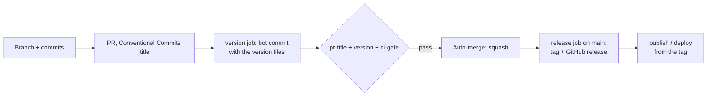

# freyr/.github

The shared PR, version and release standard of the `freyr` organization, and the
organization defaults (the PR template).

## The process



- All changes to a branch go through a PR. The ruleset of `main` has no bypass.
- The PR title is the squash commit title and the only release input.
- The version job computes the next version of each changed package and commits the
  version files to the PR branch. `main` always holds the version of the last release.
- The release job on `main` pushes only tags and creates GitHub releases. It never
  commits. The release App pushes the tags, so tag workflows start.

## Version rule

| PR title | Change |
|---|---|
| `feat: …` | minor |
| `fix: …`, `perf: …`, `revert: …` | patch |
| `feat!: …`, or `BREAKING CHANGE:` in the PR body | major (minor before 1.0.0) |
| `docs:`, `test:`, `ci:`, `build:`, `refactor:`, `chore:`, `style:` | none |

Only the packages with changed files get the change. A package with `"min_bump": "patch"`
(each Claude Code plugin) gets at least a patch when a shipped file changes.

## Use in a repo

1. Add `.github/release.json` (see [`templates/release.json`](templates/release.json)).
2. Copy [`templates/workflows/pr.yml`](templates/workflows/pr.yml) and
   [`templates/workflows/release.yml`](templates/workflows/release.yml) to
   `.github/workflows/`.
3. Add the `ci-gate` job of [`templates/ci-gate.yml`](templates/ci-gate.yml) to the CI
   workflow.
4. Copy [`templates/dependabot.yml`](templates/dependabot.yml) and add the package
   ecosystem.
5. Pin `freyr/.github/actions/*` to a commit SHA. Dependabot updates the SHA.

### `release.json`

| Key | Meaning | Default |
|---|---|---|
| `name` | package name (release title, version commit message) | required |
| `path` | folder of the package; `.` is the whole repo | `.` |
| `tag` | tag form, with `{version}` | `v{version}` |
| `legacy_tags` | older tag forms, read for the last version | `[]` |
| `version_files` | `{file, format, key}`; formats `json` (dot key, list index as number), `pyproject`, `cargo` (also `Cargo.lock`) | `[]` (tag only) |
| `ignore` | globs that are not a change of the package | `[]` |
| `min_bump` | minimum change when a file of the package changes | `none` |
| `initial` | first version when no tag and no version file exist | `0.1.0` |

## Organization configuration

| Item | Value |
|---|---|
| Variable `RELEASE_APP_ID` | ID of the release GitHub App |
| Secret `RELEASE_APP_PRIVATE_KEY` | private key of the release GitHub App |
| Release App permissions | Contents: read and write; Pull requests: read; Metadata: read |
| Ruleset `main` | default branch: PR with 0 approvals, squash only, linear history, threads resolved, required checks `pr-title`, `version`, `ci-gate`, up to date; no bypass |
| Ruleset `release-tags` | tags `v*`, `*-v*`, `*--v*`: no create, update or delete; bypass: the release App |

## Local use

```bash
python3 scripts/freyr_release.py title --title "feat(sdlc): add a stage"
python3 scripts/freyr_release.py plan --base origin/main --title "fix: x"
python3 scripts/freyr_release.py release --before HEAD~1 --dry-run
```
