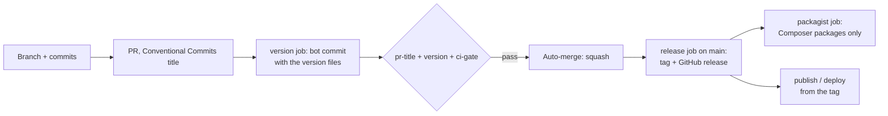

# freyr/.github

The shared PR, version and release standard of the `freyr` organization, and the
organization defaults (the PR template).

## The process



- All changes to a branch go through a PR. The ruleset of `main` has no bypass.
- The PR title is the squash commit title and the only release input.
- The version job computes the next version of each changed package and commits the
  version files to the PR branch. A run that pushes a version commit fails on purpose,
  so only the new commit can get a green `version` check. The push holds a lease on the
  PR head, so a merged or moved branch rejects it. `main` always holds the version of
  the last release. Auto-merge waits for checks only while the ruleset `main` is active.
- The release job on `main` pushes only tags and creates GitHub releases. It never
  commits. The release App pushes the tags, so tag workflows start.

## Version rule

| PR title | Change from 1.0.0 | Change before 1.0.0 |
|---|---|---|
| `feat!: …`, or `BREAKING CHANGE:` in the PR body | major | minor |
| `feat: …` | minor | patch |
| `fix: …`, `perf: …`, `revert: …` | patch | patch |
| `docs:`, `test:`, `ci:`, `build:`, `refactor:`, `chore:`, `style:` | none | none |

Before 1.0.0 each change moves one step down. A package that stays on 0.x thus gets a
minor release only for a major change (`!` in the title, or `BREAKING CHANGE:` in the
body), and a patch release for each smaller improvement or fix. Any type with `!`
is such a change, for example `refactor!:`. The step down applies to `min_bump` too.

Only the packages with changed files get the change. A package with `"min_bump": "patch"`
(each Claude Code plugin) gets at least a patch when a shipped file changes.

## Use in a repo

1. Add `.github/release.json` (see [`templates/release.json`](templates/release.json)).
2. Copy [`templates/workflows/pr.yml`](templates/workflows/pr.yml) and
   [`templates/workflows/release.yml`](templates/workflows/release.yml) to
   `.github/workflows/`.
3. Add the `ci-gate` job of [`templates/ci-gate.yml`](templates/ci-gate.yml) to the CI
   workflow.
4. Copy [`templates/dependabot.yml`](templates/dependabot.yml) and add the package
   ecosystem.
5. Pin `freyr/.github/actions/*` to a commit SHA. Dependabot updates the SHA.
6. For a Composer package on packagist.org: add the `packagist` job of
   [`templates/packagist.yml`](templates/packagist.yml) to the release workflow, and
   remove the Packagist webhook of the repo (see "Packagist").

### Packagist

Only the release workflow calls packagist.org. A repo has no Packagist webhook.

- A webhook calls packagist.org on each push, and packagist.org then lists each PR
  branch as a `dev-<branch>` version.
- The `packagist` job runs after each push to `main`. It calls the update API of
  packagist.org, which then reads the new tag and the head of `main` (`dev-main`).
- packagist.org reads all branches of the repo at that time. Turn on the repo setting
  "Automatically delete head branches", so that only `main` and the open PR branches exist.
- The secret holds the SAFE API token of the packagist.org user; that token can only
  start updates.

### `release.json`

| Key | Meaning | Default |
|---|---|---|
| `name` | package name (release title, version commit message) | required |
| `path` | folder of the package; `.` is the whole repo | `.` |
| `tag` | tag form, with `{version}` | `v{version}` |
| `legacy_tags` | older tag forms, read for the last version | `[]` |
| `version_files` | `{file, format, key}`; formats `json` (dot key, list index as number), `pyproject` (also `uv.lock`), `cargo` (also `Cargo.lock`) | `[]` (tag only) |
| `ignore` | globs that are not a change of the package | `[]` |
| `min_bump` | minimum change when a file of the package changes | `none` |
| `initial` | first version when no tag and no version file exist | `0.1.0` |

## Organization configuration

| Item | Value |
|---|---|
| Variable `RELEASE_APP_ID` | ID of the release GitHub App |
| Secret `RELEASE_APP_PRIVATE_KEY` | private key of the release GitHub App |
| Variable `PACKAGIST_USERNAME` | packagist.org user name that maintains the Composer packages |
| Secret `PACKAGIST_API_TOKEN` | SAFE API token of that packagist.org user |
| Release App permissions | Contents: read and write; Pull requests: read; Metadata: read |
| Ruleset `main` | default branch: PR with 0 approvals, squash only, linear history, threads resolved, required checks `pr-title`, `version`, `ci-gate`, up to date; no bypass; excludes the split mirrors |
| Ruleset `release-tags` | tags `v*`, `*-v*`, `*--v*`: no create, update or delete; bypass: the release App |
| Ruleset `split-mirrors` | default branch of the read-only split repos of `freyr/message-broker` (`message-broker-storage-postgresql`, `-transport-amqp`, `-webhook-http`, `-ratelimit-redis`): no update, delete or force push; bypass: the release App, whose split job mirrors each package folder |

## Local use

```bash
python3 scripts/freyr_release.py title --title "feat(sdlc): add a stage"
python3 scripts/freyr_release.py plan --base origin/main --title "fix: x"
python3 scripts/freyr_release.py release --before HEAD~1 --dry-run
```
